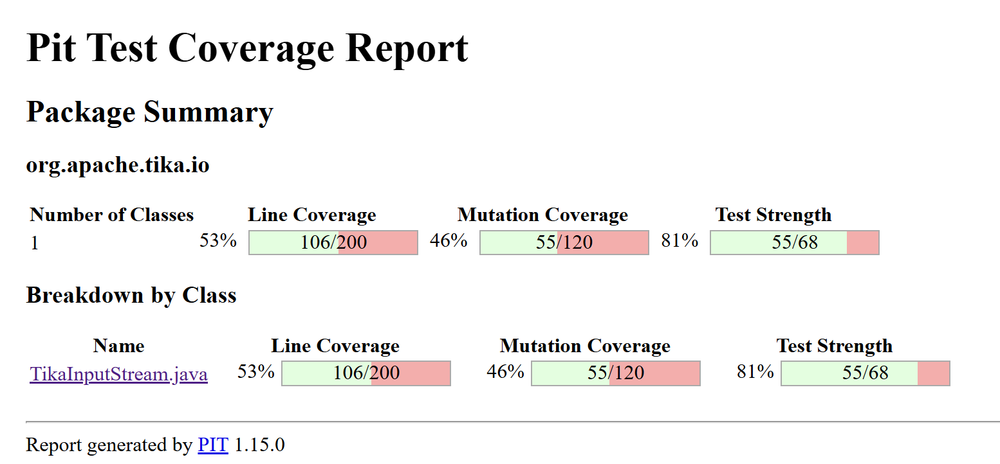
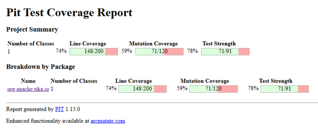
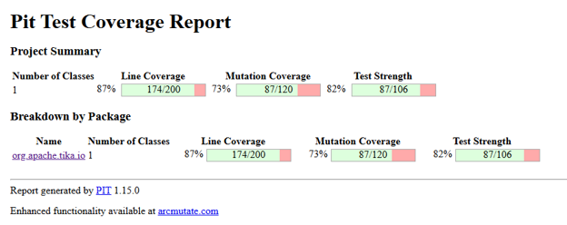

# Tâche 2 – IFT3913 : génération de tests et analyse de mutation sur `TikaInputStream`

## Correspondance avec les critères d'évaluation

---

## 1. Classes à tester

### Choix

Nous avons décider de travailler dans le module `tika-core`. Après une analyse de couverture avec JaCoCo, nous avons retenu **une seule classe** : `org.apache.tika.io.TikaInputStream`
(`tika-core/src/main/java/org/apache/tika/io/TikaInputStream.java`, 505 lignes). Les tests existants sont dans `TikaInputStreamTest.java`.

### Justification : la classe n'est pas déjà couverte

JaCoCo rapporte **52 %** de couverture pour la classe :


### Justification : la classe a des mutants vivants

Rapport avec les tests originaux uniquement :




| Mesure | Valeur |
|---|---|
| Lignes couvertes | 106 / 200 (53 %) | 
| Mutants couverts par au moins un test | 68 | 
| Mutants tués | 55 | |
| Mutants vivants (couverts mais non tués) | 13 |
| Mutants jamais atteints par un test | 52 | 
| Score de mutation | 55 / 120 (46 %) | 

Il y a donc 13 mutants vivants, et 52 autres mutants dans du code qu'aucun test n'exécute, une bonne raison de travailler.
(La configuration pitest est décrite dans la section 4.)

### Méthodes ciblées (non couvertes par les tests originaux)

D'après la lecture de `TikaInputStreamTest.java` d'origine, les méthodes suivantes ne sont jamais appelées ou seulement en partie :

| Méthode / zone (lignes de `TikaInputStream.java`) | Constat |
|---|---|
| `get(Blob)`, `get(Blob, Metadata)` (165-186) | jamais appelées, y compris le seuil `BLOB_SIZE_THRESHOLD` |
| `get(URI)`, `get(URI, Metadata)` (188-200) | jamais appelées |
| `get(URL, Metadata)` (206-246) | seule la branche « fichier local » est exercée (via `testGetMetadata`) ; la partie `URLConnection` (218-245) ne l'est pas |
| `get(File)`, `get(File, Metadata)` (157-163) | jamais appelées |
| `getFromContainer`, `setOpenContainer`, `addCloseableResource` (248-255, 361-370) | jamais appelées |
| `getFile`, `getFileChannel` (385-393) | jamais appelées |
| `setLength`, `getLength` pour un flux de longueur inconnue (403-418, 428-430) | seul `byte[]` est testé ; ni la surcharge de longueur ni le forçage du fichier temporaire |
| `toString` (489-504) | jamais appelée |
| `afterRead`, branche EOF (328-334) | Limite des 1000 EOF consécutifs non testée |
| `close()` avec close shield (311-321) | la fermeture effective n'est jamais vérifiée |

---

## 2. IA et test : ChatUniTest dans le pipeline Maven

ChatUniTest est un plugin Maven (`chatunitest-maven-plugin`) qui génère des tests unitaires avec un LLM exécuté localement, puis les valide et les corrige.

### Configuration utilisée

```xml
<plugin>
  <groupId>io.github.zju-aces-ise</groupId>
  <artifactId>chatunitest-maven-plugin</artifactId>
  <version>2.1.1</version>
  <configuration>
      <apiKeys>NO_API</apiKeys>
      <model>codeqwen:v1.5-chat</model>
      <url>http://localhost:11434/v1/chat/completions</url>
      <selectClass>org.apache.tika.io.TikaInputStream</selectClass>
      <testNumber>2</testNumber>
      <maxRounds>2</maxRounds>
      <thread>false</thread>
  </configuration>
  <dependencies>
      <dependency>
          <groupId>io.github.ZJU-ACES-ISE</groupId>
          <artifactId>chatunitest-starter</artifactId>
          <version>1.4.0</version>
          <type>pom</type>
      </dependency>
  </dependencies>
</plugin>
```

- Modèle de langage ouvert utilisé : `codeqwen:v1.5-chat` exuté localement.
- Commandes Ollama (Windows PowerShell) pour installer et exécuter le modèle localement : `irm https://ollama.com/install.ps1 | iex`, puis `ollama pull codeqwen:v1.5-chat` et `ollama run codeqwen:v1.5-chat` pour vérifier qu'il fonctionne bien.
- Commande Maven exécutée : `.\mvnw.cmd -pl tika-core io.github.zju-aces-ise:chatunitest-maven-plugin:2.1.1:class`

---

## 3. Tests générés par ChatUniTest

Chaque test est décrit ci-dessous. Les numéros de ligne renvoient à `TikaInputStream.java`.

### Test G1 — `getBlob_exactlyAtThreshold_isStillByteArray` (l. 1103)

- **Explication :** un Blob de 1 048 576 octets (exactement `BLOB_SIZE_THRESHOLD`) doit être lu par un `ByteArraySource`. Le Blob est simulé avec `java.lang.reflect.Proxy`, sans bibliothèque de mock.
- **Pertinence :** vise la condition `length <= BLOB_SIZE_THRESHOLD` (l. 177) au point exact où `<=` et `<` diffèrent.
- **Critique :** bonne donnée de test (valeur limite). L'oracle `instanceof ByteArraySource` dépend de l'implémentation interne, pas du comportement observable ; il casserait si la classe était refactorisée.

### Test G2 — `getBlob_aboveThreshold_isStreamedThroughCachingSource` (l. 1113)

- **Explication :** un Blob de 1 Mo + 1 octet doit passer par un `CachingSource`, la longueur doit être écrite dans les métadonnées et le contenu relu intact.
- **Critique :** complète G1 de l'autre côté de la limite. Il alloue 1 Mo, ce qui est acceptable. Le contrôle du contenu (`assertArrayEquals`) est un oracle fort ; le `instanceof` reste lié à l'implémentation.

### Test G3 — `getPath_setsResourceNameAndContentLength_butKeepsExistingName` (l. 1125)

- **Explication :** `get(Path, Metadata)` doit renseigner `RESOURCE_NAME_KEY` et `CONTENT_LENGTH`, sans écraser un nom déjà présent.
- **Critique :** oracle précis sur des valeurs concrètes (`"named.txt"`, `"5"`). Bon test de comportement ; il ne vérifie pas le cas d'un nom « blanc » (espaces), que `StringUtils.isBlank` couvre pourtant.

### Test G4 — `getUriAndUrl_regularFile_areFileBacked` (l. 1143)

- **Explication :** `get(URI)` et `get(URL)` sur un fichier régulier doivent produire un flux adossé à un fichier (`hasFile()`), avec le bon nom de ressource et le bon contenu.
- **Critique :** vérifie le contenu et le chemin, donc oracle solide. Le chemin `get(URI)` délègue à `get(URL)`, de sorte que plusieurs mutants sur `get(URI)` sont équivalents (voir section 6).

### Test G5 — `getUriAndUrl_missingFile_throwIOException` (l. 1164)

- **Explication :** un fichier inexistant doit provoquer une `IOException`.
- **Critique :** c'est le test le plus faible du lot. Il n'affirme que le type d'exception : la même `IOException` serait levée même si la condition `Files.isRegularFile` était inversée (le chemin alternatif échoue aussi, dans `Files.size`). Il augmente surtout la couverture de lignes (218-244), sans tuer de mutant sur ces lignes, car les métadonnées modifiées sont locales et inobservables.

### Test G6 — `getLength_streamWithUnknownLength_forcesSpillAndReturnsRealLength` (l. 1171)

- **Explication :** pour un `InputStream` sans longueur connue, `hasLength()` est faux ; `getLength()` force l'écriture dans un fichier temporaire et renvoie la vraie longueur (13).
- **Critique :** bon test : il vérifie l'état avant et après (`hasLength` faux puis vrai, `hasFile` vrai). Suppose que `CachingSource.getLength()` renvoie -1 tant que rien n'a été écrit.

### Test G7 — `reset_resetsEofCounter` (l. 1182)

- **Explication :** `mark()` au début d'un flux vide, 1000 lectures EOF, puis `reset()` et une nouvelle lecture qui doit renvoyer -1 sans exception.
- **Critique :** utile pour la limite `mark < 0` de `reset()` (mark à la position 0 valide). L'effet sur le compteur d'EOF est un comportement réel, mais PIT ne mute pas l'affectation `consecutiveEOFs = 0` avec ses mutateurs par défaut ; le test vérifie donc surtout ce comportement.

### Test G8 — `rewind_resetsPosition_andInvalidatesMark` (l. 1194)

- **Explication :** après `mark()`, lecture de 4 octets et `rewind()`, la position vaut 0, `reset()` échoue et la relecture donne le contenu complet.
- **Critique :** recoupe `testRewind` (test original) pour la position et le contenu. Il apporte l'invalidation du mark, un comportement que PIT ne mute pas par défaut. Utile comme spécification, peu utile pour le score.

### Test G9 — `closeShield_isReentrant_andProtectsTemporaryFile` (l. 1208)

- **Explication :** deux `setCloseShield()` imbriqués ; `close()` ne doit pas supprimer le fichier temporaire tant que le shield est actif, et doit le supprimer une fois les deux niveaux levés.
- **Critique :** oracle fort, car il observe un effet réel (existence du fichier). C'est le seul test qui détecte un mutant sur la condition de `close()` (l. 312). Il recoupe partiellement `testCloseShieldMutation` pour les compteurs.

### Test G10 — `setLength_zeroOverridesUnknownLength` (l. 1232)

- **Explication :** `setLength(0)` doit être pris en compte (`hasLength()` vrai, `getLength()` égal à 0).
- **Critique :** test minimal mais ciblé sur la valeur limite 0 de `overrideLength >= 0`. Il ne vérifie pas qu'aucun fichier temporaire n'a été créé.

---

## 4. Analyse de mutation (PIT)

### Configuration

PIT 1.15.0, avec les mutateurs par défaut (conditionals boundary, negate conditionals, increments, math, invert negatives, void method calls, return-value mutators), ciblant uniquement la classe étudiée.

```xml
<plugin>
  <groupId>org.pitest</groupId>
  <artifactId>pitest-maven</artifactId>
  <version>1.15.0</version>
  <configuration>
      <targetClasses>
          <param>org.apache.tika.io.TikaInputStream</param>
      </targetClasses>
      <targetTests>
          <param>org.apache.tika.io.TikaInputStreamTest</param>
      </targetTests>
  </configuration>
  <dependencies>
    <dependency>
      <groupId>org.pitest</groupId>
      <artifactId>pitest-junit5-plugin</artifactId>
      <version>1.2.2</version>
    </dependency>
  </dependencies>
</plugin>
```

Commande : `.\mvnw.cmd -pl tika-core org.pitest:pitest-maven:mutationCoverage`

### Résultats

| Étape | Lignes couvertes | Mutants tués / générés (score de mutation) |
|---|---|---|---|
| 1. Tests originaux | 106 / 200 (53 %) | 55 / 120 (46 %) |
| 2. Avec tests ChatUniTest | 148 / 200 (74%) | 71 / 120 (59%) | 
| 3. Avec tests ChatUniTest et tests manuels| 174 / 200 (69 %) | 87 / 120 (73%) | 





**Gain observé (étape 1 → 3) :** +68 lignes couvertes, + mutants tués (55 → 87), + score de mutation de 46 % à 73 %.

**Mutants restants après l'étape 3 :**

| | Nombre | Calcul |
|---|---|---|
| Vivants (couverts non tués) | 16 | 87 − 71 |

**Les tests générés détectent-ils tous les mutants ? -> Non.** 

---

## 5. Documentation des mutants détectés

Pour chaque test ajouté, voici les mutants visés, selon notre analyse du code, et la raison de la détection.

| Test | Ligne(s) | Mutation PIT visée | Raison |
|---|---|---|---|
| G1 | 177 | *changed conditional boundary* : `length <= SEUIL` devient `length < SEUIL` | Avec exactement 1 048 576 octets, le mutant choisit la branche `CachingSource` ; `instanceof ByteArraySource` devient faux. |
| G1, G2 | 177 | *negated conditional* sur la condition du Blob | Un Blob de 1 Mo irait vers `CachingSource` (G1), un Blob de 1 Mo + 1 vers `ByteArraySource` (G2) ; les deux `instanceof` échouent. |
| G2 | 173 | *removed call to* `metadata.set(CONTENT_LENGTH, …)` | La métadonnée n'est plus écrite ; `assertEquals("1048577", …)` échoue. |
| G3 | 135 | *negated conditional* sur `isBlank(nom)` | Avec un `Metadata` vide, le nom n'est pas posé ; avec un nom existant, il est écrasé. Les deux assertions échouent. |
| G3 | 136, 138 | *removed call to* `metadata.set(…)` | Le nom ou la longueur manque dans les métadonnées. |
| G4 | 207, 210 | *negated conditional* (`"file"` et `isRegularFile`) dans `get(URL)` | Le fichier passerait par `URLConnection` et un `CachingSource` : `hasFile()` serait faux. |
| G4 | 196, 199, 211 | *replaced return value with null* | `tis` est nul : l'appel `tis.hasFile()` lève une `NullPointerException`. |
| G6 | 412 | *negated conditional* sur `len == -1` | Le spill n'a pas lieu ; `getLength()` renverrait -1 au lieu de 13. |
| G6 | 414 | *removed call to* `getPath()` | Même effet : la longueur reste -1. |
| G6 | 400, 401 | *negated conditional* / *replaced boolean return* dans `hasLength()` | `assertFalse` avant lecture et `assertTrue` après échouent. |
| G6 | 417 | *replaced long return with 0* | `assertEquals(13, …)` échoue. |
| G7 | 298 | *changed conditional boundary* : `mark < 0` devient `mark <= 0` | Le mark est posé à la position 0 : `reset()` lèverait une exception à tort. |
| G8 | 453, 454 | *negated conditional* sur `source != null`, *removed call to* `seekTo(0)` | L'appel lève une exception, ou la relecture ne repart pas du début. Déjà détecté par `testRewind`. |
| G9 | 312 | *changed conditional boundary* : `closeShieldDepth > 0` devient `>= 0` | Avec une profondeur de 0, `close()` retournerait sans rien fermer : le fichier temporaire survivrait et `assertFalse(Files.exists(…))` échouerait. Seul G9 le détecte. |
| G9 | 433, 437, 441 | *increments* (`++` ↔ `--`) et *conditional boundary* sur `isCloseShield` | Les assertions `isCloseShield()` vrai/faux se contredisent. Détecté aussi par `testCloseShieldMutation`. |
| G10 | 396, 404 | *changed conditional boundary* : `overrideLength >= 0` devient `> 0` | `setLength(0)` serait ignoré : `hasLength()` faux (l. 396) ou longueur de 5 au lieu de 0 (l. 404). |

### Mutants non détectés et mutants équivalents

- **G5** n'a tué aucun mutant dans le code qu'il fait exécuter (l. 218-244) : les écritures dans `metadata` y sont locales à l'appel et l'exception arrête la méthode avant que le résultat soit observable. Ces mutants restent vivants. Un test avec un serveur HTTP local (contrôle des en-têtes `Content-Type`, `Content-Length`) permettrait de les tuer, mais nous ne l'avons pas fait pour ce travail.
- **Mutants équivalents sur `get(URI)` (l. 193, 195)** : si la condition est inversée, le code poursuit vers `get(uri.toURL(), …)`, qui traite lui aussi le fichier local ; le résultat observable est identique, donc aucun test ne peut les tuer.


## 6. Tests supplémentaires écrits à la main

Ces cinq tests se trouvent dans `TikaInputStreamTest.java` sous le commentaire `// Tests manuels` (lignes 1006 à 1095). Ils ont été écrits à partir des mutants survivants du rapport PIT.

### M1 — `testInitialPosition` (l. 1009)

- **Intention :** un flux neuf est à la position 0 et un tableau d'octets a une longueur connue.
- **Données :** `"Test"` (4 octets, contenu non vide et simple) ; un `byte[]` donne une longueur immédiatement connue.
- **Oracle :** `position` est initialisé à 0 (champ de la classe) ; `hasLength()` doit être vrai pour un `byte[]`, donc `assertEquals(0, getPosition())` et `assertTrue(hasLength())`. Vise le mutant « replaced boolean return » sur `hasLength`.

### M2 — `testConsecutiveEOFsLimit` (l. 1017)

- **Intention :** une source qui ne renvoie que des EOF doit finir par lever une `IOException` (garde contre les boucles infinies, l. 328-334).
- **Données :** un `InputStream` anonyme dont `read()` renvoie toujours -1 ; 1006 lectures, c'est-à-dire un peu plus que la limite de 1000.
- **Oracle :** d'après `afterRead`, plus de 1000 EOF consécutifs lèvent une `IOException` ; `assertThrows` l'exige. Tue le mutant *increment* (l. 329) et *negated conditional* (l. 330). Limite : n'impose pas où l'exception survient, donc la frontière exacte est vérifiée par M5.

### M3 — `testCloseShieldMutation` (l. 1036)

- **Intention :** le compteur de profondeur du close shield est correct et imbriquable.
- **Données :** profondeur 0, puis 1, puis 2, puis retour à 1 et 0, pour exercer chaque transition.
- **Oracle :** `isCloseShield()` est vrai si et seulement si la profondeur est supérieure à 0. Tue les mutants *increments* des l. 433 et 437 et le mutant de frontière de l. 441. Le test n'appelle pas `close()` : l'effet sur la fermeture est vérifié par G9.

### M4 — `testContainerAndResourcesAndToString` (l. 1052)

- **Intention :** `getFromContainer`, `getOpenContainer`, la longueur imposée, `markSupported`, `addCloseableResource`, `getFile`, `getFileChannel` et `toString`.
- **Données :** un conteneur `Closeable` simulé (lambda), longueur 42, un `byte[]` `"TestFile"`. La lambda permet d'observer que la fermeture a bien eu lieu.
- **Oracle :** d'après le code, `getFromContainer` enregistre le conteneur et la longueur (`42`, y compris dans `CONTENT_LENGTH`) ; un conteneur `Closeable` est fermé à la fermeture du flux ; `markSupported()` est toujours vrai ; `toString()` contient le chemin du fichier. Limite connue : `toString().contains("in")` est un oracle faible (la sous-chaîne `" (in "` serait plus précise).

### M5 — `testExactConsecutiveEOFsBoundary` (l. 1081)

- **Intention :** fixer la frontière exacte de la limite d'EOF.
- **Données :** exactement 1000 lectures EOF acceptées, puis une 1001e qui doit échouer.
- **Oracle :** `consecutiveEOFs > MAX_CONSECUTIVE_EOFS` avec `MAX = 1000` : les 1000 premières lectures renvoient -1, la 1001e lève une `IOException`. Tue le mutant *changed conditional boundary* de la l. 330.

---

## 8. Déclaration d'usage de l'IA

Nous déclarons avoir utilisé **ChatUniTest** pour générer des tests unitaires, puis les avoir validés et corrigés. Nous avons également écrit des tests manuels pour compléter la couverture et tuer des mutants restants.
Nous déclarons également avoir utilisé des outils comme **Gemini**, **ChatGPT** ou encore **Claude** pour l'aide à la rédaction de ce rapport, ainsi que pour le troubleshooting lors de la configuration des outils et dépendences nécéssaires à l'exécution et à la génération des tests, ainsi que de l'analyse de mutation.
